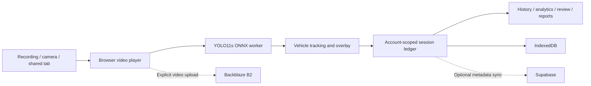

<div align="center">
  
  <h1>VisionGuard</h1>
  <p><strong>Browser-first traffic video intelligence.</strong></p>
  <p>Detect vehicles, track movement, review observations and export findings from a single workspace.</p>
  <p><a href="https://visionguard.syednazeerofficial2007.workers.dev/">Live application</a> · <a href="#getting-started">Quick start</a> · <a href="docs/README.md">Documentation</a></p>
  <a href="https://github.com/Syed-Nazeer-07/VisionGuard/actions/workflows/ci.yml"></a>
</div>

## Overview

VisionGuard is a computer-vision application for examining traffic footage in a browser. Its YOLO11s ONNX detector runs in a dedicated web worker, with optical tracking maintaining session-level vehicle IDs across frames. Local-first analysis records power the history, analytics, incident review and reporting tools.

Unlike a conventional server-based inference pipeline, VisionGuard processes video locally using WebGPU or a supported WASM fallback. No persistent Python inference server is required.

**Status:** Functional core workflow / release candidate. Real-world accuracy and optional cloud integrations require environment-specific validation.

## Capabilities

| Area | Functionality |
| --- | --- |
| Video sources | Local recordings, authorized camera input and permission-granted browser-tab capture |
| Live analysis | Vehicle classification, tracking overlays, playback controls, seeking, playback speed and composite fullscreen |
| Analytics | Session history, repeatedly observed track IDs, class distribution and recorded observations |
| Incident review | Automatic review candidates, manual flags and reviewed/dismissed/reopened states |
| Reports | Session and vehicle PDF/CSV exports; incident-review CSV |
| Data controls | Account-scoped local metadata, optional cloud synchronization and explicit original-video retention |
| Interface | Responsive navigation, light/dark/system appearance and account settings |

VisionGuard analyzes one source at a time. It does not scrape streams or download YouTube videos. Browser-tab capture requires user consent.

## Architecture



| Layer | Technology |
| --- | --- |
| Frontend | React 19, TypeScript, Vite, Tailwind CSS |
| Inference | YOLO11s, ONNX Runtime Web, Web Workers, optical tracking |
| Identity and metadata | Supabase Auth, PostgreSQL, row-level security |
| Local persistence | IndexedDB |
| Optional original-video storage | Backblaze B2 via authenticated Supabase Edge Functions |
| Hosting | Cloudflare Workers |
| Quality | Vitest, Oxlint, browser smoke tests, tracking evaluation and GitHub Actions |

See the [architecture guide](docs/ARCHITECTURE.md) for runtime boundaries and compatibility details.

## Getting started

**Requirements:** Git, Node.js 22, npm and a modern Chromium browser (Chrome or Edge recommended).

```bash
git clone https://github.com/Syed-Nazeer-07/VisionGuard.git
cd VisionGuard
npm ci
npm run dev
```

Open [http://localhost:3000](http://localhost:3000).

### Configure detection

The model weights are not committed. Provide a compatible, appropriately licensed YOLO11s ONNX export at:

```text
apps/web/public/models/yolo11s.onnx
```

Alternatively set a public HTTPS model URL with `VITE_YOLO_MODEL_URL` in `apps/web/.env.local`. Review the [model setup and validation guide](docs/MODEL_SETUP.md) before choosing an export. Without compatible weights, the interface can load but inference cannot run.

### Configure authentication and optional cloud services

Copy `apps/web/.env.example` to `apps/web/.env.local` and set the public browser configuration:

```env
VITE_SUPABASE_URL=https://YOUR-PROJECT.supabase.co
VITE_SUPABASE_ANON_KEY=YOUR_PUBLIC_PUBLISHABLE_KEY
VITE_VIDEO_STORAGE_PROVIDER=b2
```

Without valid Supabase configuration, the local demo adapter is available; sample records are not genuine analysis results. Configured cloud synchronization requires the database migrations and access policies. Optional B2 upload requires separate server-side credentials and storage configuration.

Never expose service-role keys, OAuth client secrets or B2 application keys in browser variables or commits.

## Development and verification

```bash
npm run lint
npm run build
npm run test -w web
npm run test:architecture
npm run test:tracking-eval
npm run test:deploy
```

CI also verifies public navigation and responsive layout in Chrome. The production build is `npm run build:pages`; follow the [Cloudflare deployment guide](docs/CLOUDFLARE_PAGES.md) for the required environment settings.

A green build is not a guarantee of detection accuracy, live model availability, authentication, or successful production storage operations. See the [release checklist](docs/RELEASE_CHECKLIST.md) and [tracking evaluation guide](docs/BROWSER_TRACKING_EVALUATION.md).

## Repository structure

```text
apps/web/          Browser application, inference worker and tests
worker/            Cloudflare Worker and routing tests
supabase/          Database migrations, edge functions and auth templates
scripts/           Build checks, model tools and regression utilities
docs/              Architecture, setup, operation and evaluation guides
.github/           CI and model export workflows
```

## Responsible use

- Original footage is not automatically uploaded for detection. Retention and B2 upload are opt-in.
- Speed readings are **uncalibrated visual estimates**, not verified road speeds. Review flags are not confirmed offences.
- Tracking IDs are session-scoped, not licence plates or persistent vehicle identities. Occlusion and ID switches can affect counts.
- Use only footage you are authorized to analyze.

Read the [operations and privacy guide](docs/OPERATIONS.md) for storage, recovery and synchronization behavior.

## Documentation and contribution

- [Documentation index](docs/README.md)
- [Contribution guide](CONTRIBUTING.md)
- [Security reporting](SECURITY.md)
- [Media credits and third-party licensing notes](docs/MEDIA_CREDITS.md)

A repository-wide software license has not been selected. Third-party code, model weights and media remain subject to their respective licenses.

---

Built and maintained by [Syed Nazeer](https://github.com/Syed-Nazeer-07).
